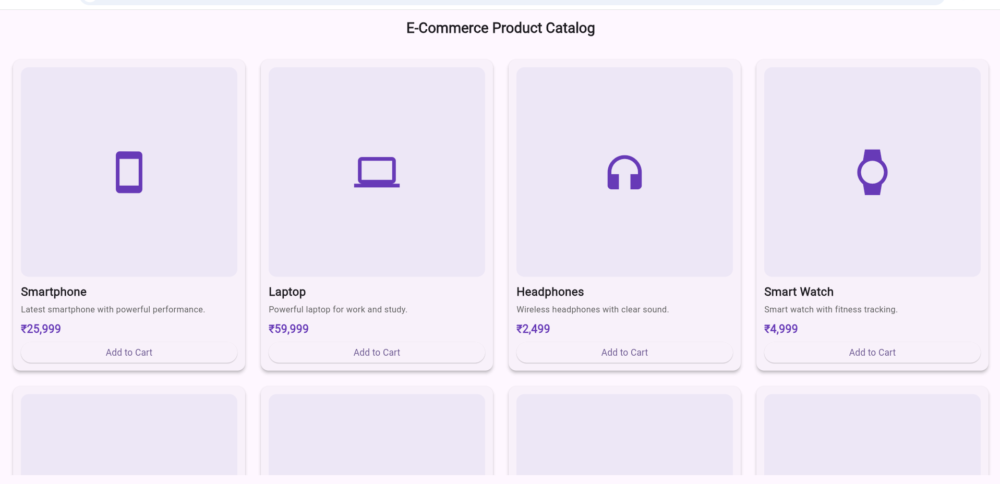
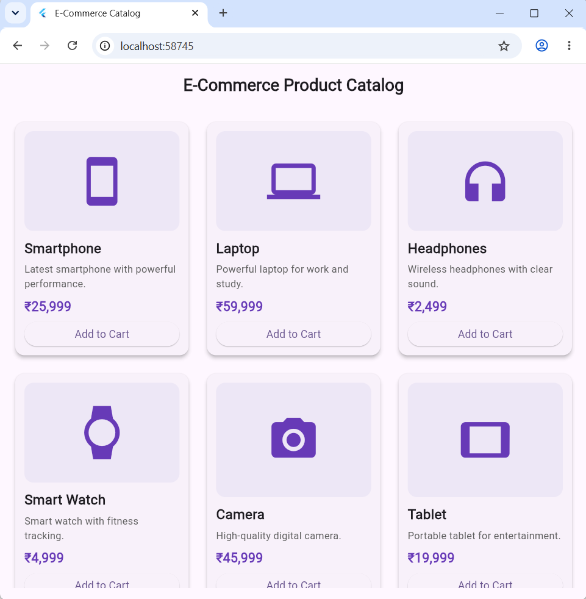
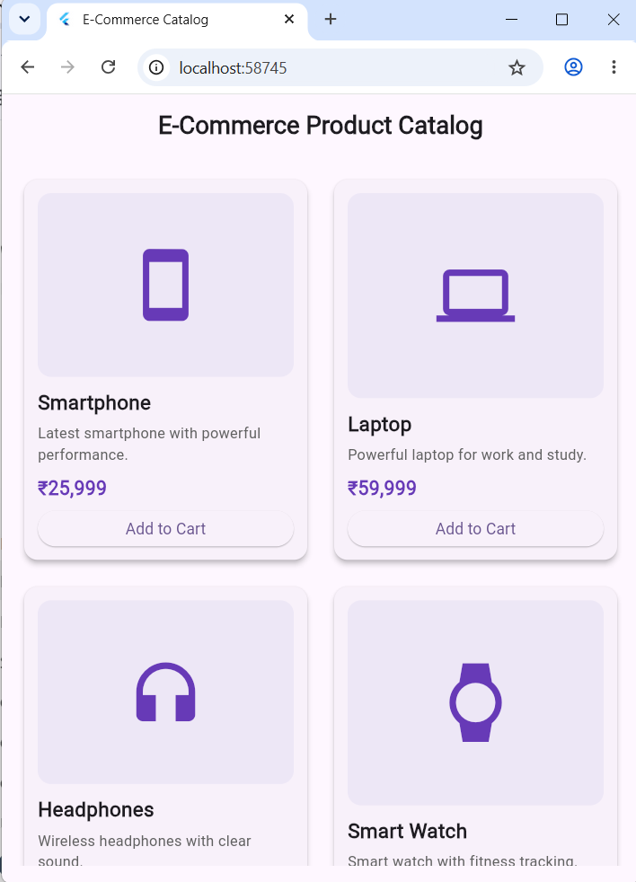

# Experiment 2 – Adaptive and Responsive UI Design

## Aim

To design and develop a responsive Flutter application for an E-Commerce Product Catalog using reusable custom product widgets and responsive layout techniques.

## Description

This experiment demonstrates the development of a responsive E-Commerce Product Catalog using Flutter and Dart.

The application uses reusable custom ProductCard widgets to display product information such as product name, description, price, and Add to Cart button.

Responsive design is implemented using LayoutBuilder and GridView. The number of product columns changes according to the available screen width.

- Small screen – 2 columns
- Medium screen – 3 columns
- Large screen – 4 columns

## Technologies Used

- Flutter
- Dart
- LayoutBuilder
- GridView
- Custom Widgets
- Material Design

## Output Screenshots

### Large Screen – 4 Columns

### Medium Screen – 3 Columns

### Small Screen – 2 Columns

## Result

A responsive E-Commerce Product Catalog was successfully designed and implemented using Flutter and Dart. The application adapts its layout according to different screen sizes using responsive design techniques.
